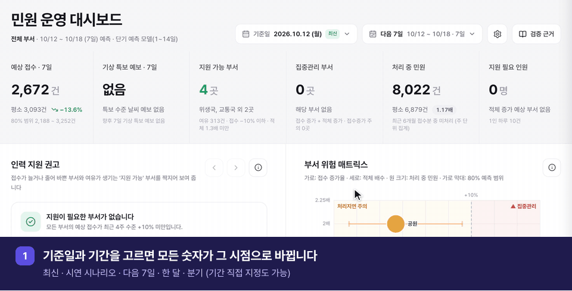
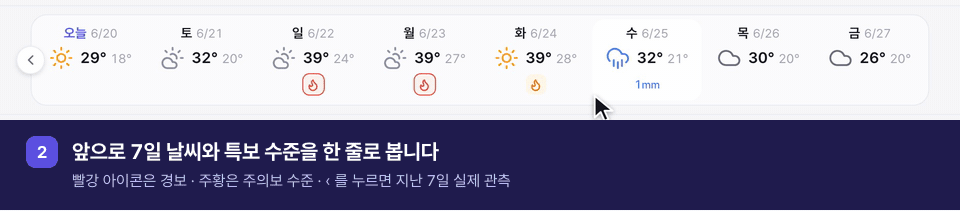
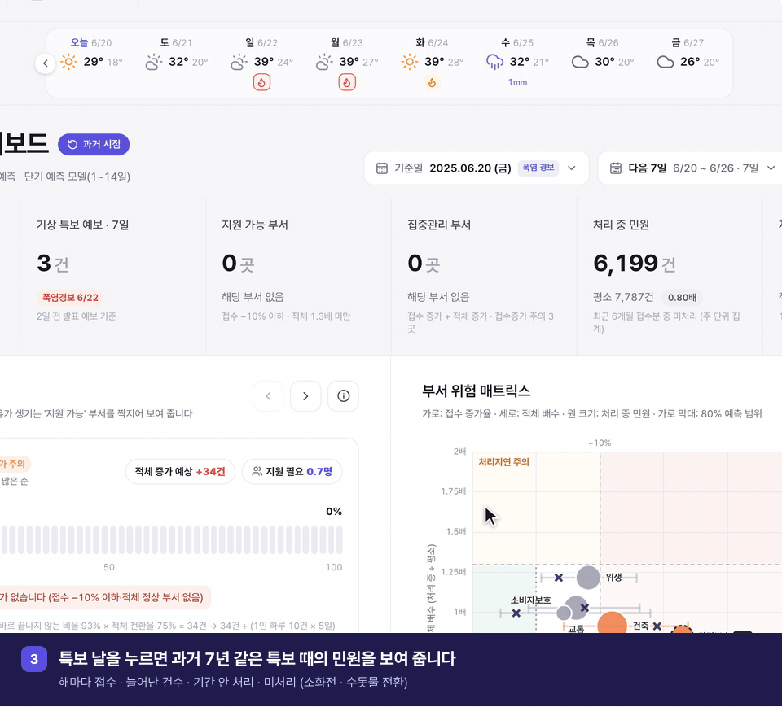
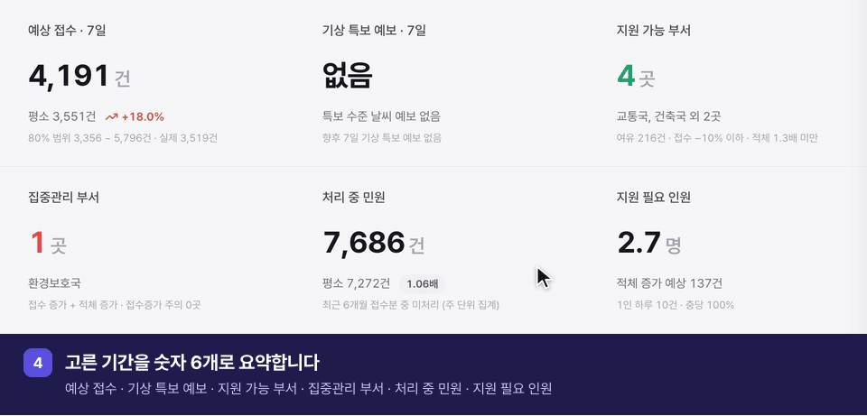
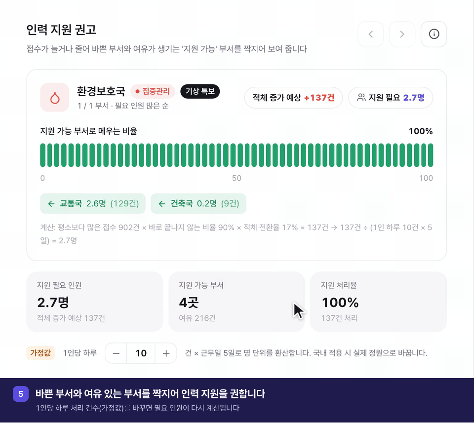
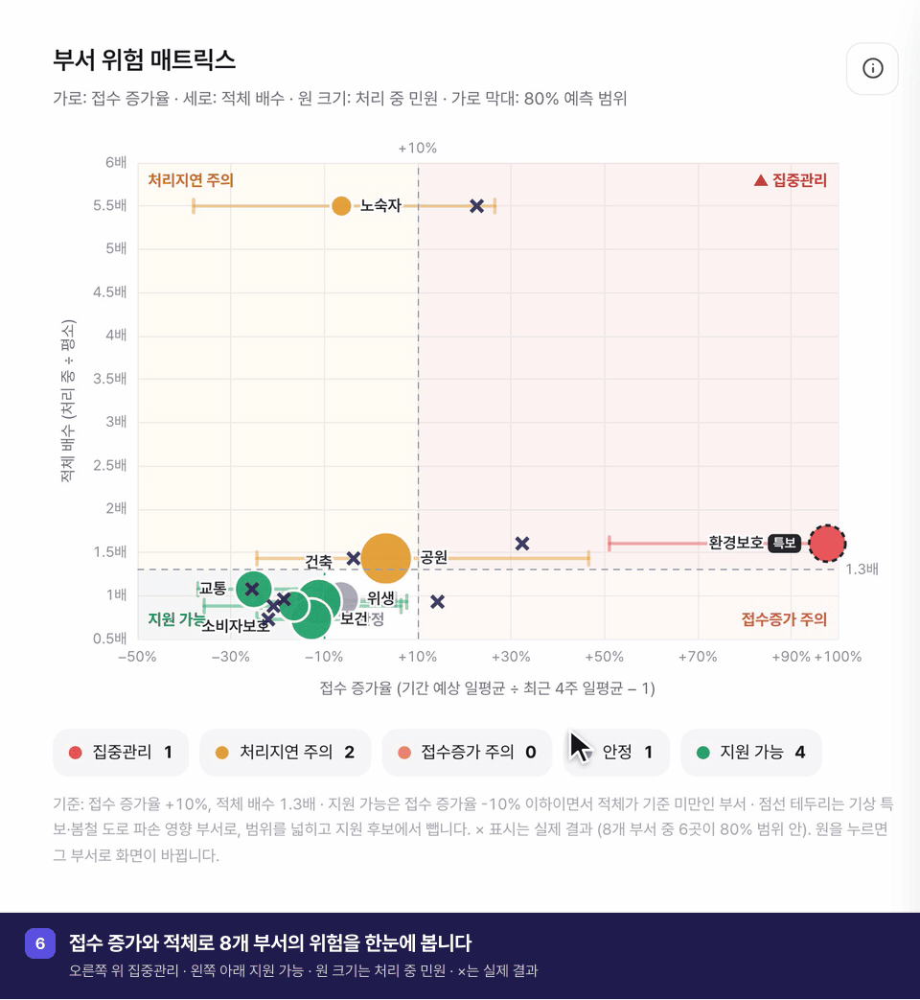
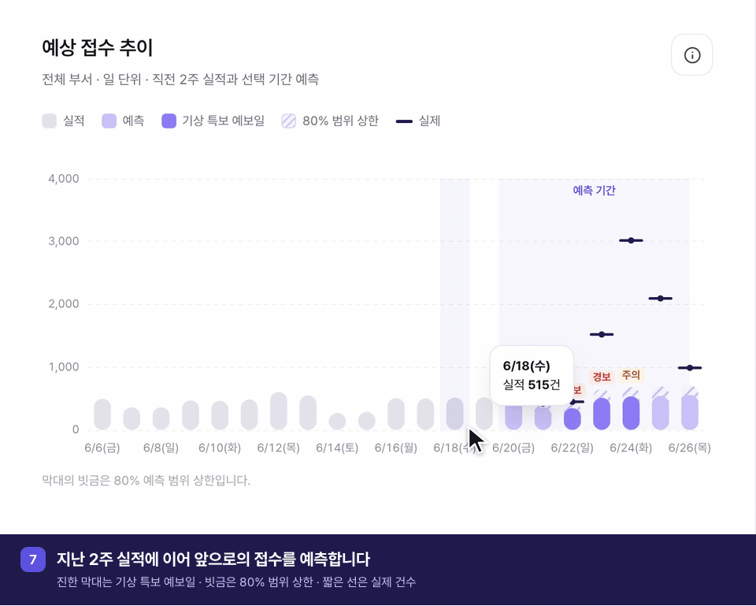
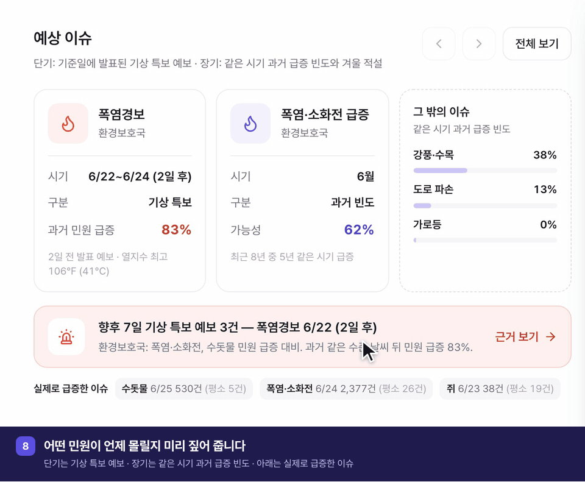
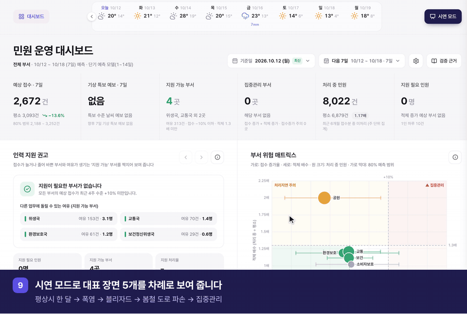

# 스마트 민원케어 — 민원 조기경보 · 인력 지원 대시보드

민원이 몰릴 곳을 미리 알려 주고, 바빠질 부서와 도울 수 있는 부서를 이어 주는 행정 지원 대시보드입니다.

**바로 보기:** http://129.225.152.209 (시연용 공개 서버, 시연 기간에만 운영)

## 실행 방법

준비물: macOS, [uv](https://docs.astral.sh/uv/), Node.js. 저장소에는 데이터 파일이 들어 있지 않으므로, 처음이라면 [데이터 받기](docs/실행_가이드.md#데이터-다시-만들기)를 먼저 실행합니다.

```bash
# 1) 설치 (처음 한 번)
brew install uv libomp                          # libomp는 LightGBM용
uv sync                                         # Python 3.12 환경과 패키지
cd frontend && npm install && npm run build && cd ..

# 2) 사전 계산 (처음 한 번, 데이터를 바꾼 뒤. 약 3분)
uv run python -m engine.build

# 3) 실행 → http://127.0.0.1:8000 (API 문서는 /docs)
uv run uvicorn app.main:app --app-dir backend
```

화면 오른쪽 위 **시연 모드**를 누르면 평상시 → 폭염 → 블리자드 → 봄철 도로 파손 → 집중관리 순서로 진행합니다.
개발 모드, 테스트, 데이터·검증 다시 만들기는 [docs/실행_가이드.md](docs/실행_가이드.md)에 있습니다.

## 프로젝트 소개

### 왜 만들었나

- 공공부문 민원은 연 2,000만 건이 넘고, 날씨가 크게 바뀌면 특정 민원이 한꺼번에 몰립니다. 분석한 뉴욕 데이터에서는 2025년 6월 폭염 때 브롱크스 소화전 민원이 하루 2,377건으로 평소의 91배였습니다.
- 지금은 민원이 몰린 뒤에야 인력을 돌립니다. 기존 서비스(국민권익위원회 「한눈에 보는 민원 빅데이터」)는 지난 통계와 월 단위 예보가 중심이라 부서별 업무 부담은 보이지 않습니다.

### 무엇을 하나: 세 가지 질문에 답합니다

| 질문 | 화면 | 방법 | 결과 (2022~2026 과거 재현) |
|---|---|---|---|
| 앞으로 민원이 얼마나 들어오나 | 핵심 지표, 예상 접수 추이 | 1~14일은 LightGBM, 한 달·분기는 계절 지수 × 최근 수준 | 다음 1주 오차 16.6%, 한 달 14% |
| 어떤 민원이 언제 몰리나 | 7일 기상 예보 띠, 예상 이슈 | 미국 기상청 특보 기준에 그날 발표된 예보를 대입, 같은 시기 과거 급증 빈도 | 폭염을 1일 전 예보로 97% 포착, 경보 수준 날 뒤 민원 급증 83% |
| 어느 부서가 바빠지고 누가 도울 수 있나 | 부서 위험 매트릭스, 인력 지원 권고 | 접수 증가율(+10%) × 적체 배수(1.3배)로 네 칸 판정, 적체 전환율로 필요 인원 환산 | 지원이 필요했던 주의 71%에 도울 부서가 있었고, 필요량의 평균 52%를 채움 |

### 화면 구성

화면 위에서부터 차례로, 기능마다 그 영역만 확대해 담았습니다. 이 밖에 부서별 현황 표와 검증 근거 창이 있습니다.

**1. 기준일 · 기간 선택**



**2. 7일 기상 예보 띠**



**3. 특보 날 상세**



**4. 핵심 지표**



**5. 인력 지원 권고**



**6. 부서 위험 매트릭스**



**7. 예상 접수 추이**



**8. 예상 이슈**



**9. 시연 모드**



### 데이터

- 뉴욕시 311 민원: 브롱크스 8개 부서, 2016-01 ~ 2026-10, 1,546,798건
- Open-Meteo: 기상 관측, 1~7일 전에 발표된 과거 예보
- 미국 기상청(NWS) 뉴욕 지청: 특보 기준, 실제 발표 특보 1,091건

국내 민원은 건별 처리 기록이 공개되지 않아, 10년 넘게 같은 형태로 공개된 뉴욕 데이터로 방법을 먼저 검증했습니다. 국내에 적용할 때는 기관 민원 자료와 기상청 예보·특보로 다시 학습합니다.

### 동작 방식

무거운 계산(예측·특보 판정·인력 계산)은 시연 전에 기준일 145개마다 미리 끝내 저장하고(약 3분), 끝에 시연 장면 숫자를 검증표와 자동 대조합니다. 시연 중에는 FastAPI 서버가 저장된 결과에 가벼운 계산만 더해 응답하고(2~22ms, 맥북 기준), 인터넷 없이 노트북 한 대로 동작합니다.

### 한계

- 폭염·폭설처럼 큰 날씨가 오는 주의 건수는 숫자로 맞히지 못해, 특보 경보로 대신 알립니다.
- 집중관리 판정은 정밀도 44%라 확정이 아닌 가능성으로 표시합니다.
- 인원(명)은 1인 하루 10건이라는 가정값으로 환산하며, 화면에서 바꿀 수 있습니다.

## 문서

- 기획 기준: [docs/서비스기획_정리.md](docs/서비스기획_정리.md)
- 10년치 검증 결과: [docs/검증결과_10년.md](docs/검증결과_10년.md)
- 시연 리허설 검증: [docs/리허설_검증.md](docs/리허설_검증.md)
- 7일 기상 예보 띠 검증: [docs/기상예보_기능_검증.md](docs/기상예보_기능_검증.md)
- 개발 설계: [docs/개발설계.md](docs/개발설계.md)
- 실행 가이드: [docs/실행_가이드.md](docs/실행_가이드.md)
- 데이터 설명: [data/NYC311_컬럼설명.md](data/NYC311_컬럼설명.md), [data/processed/README.md](data/processed/README.md)
